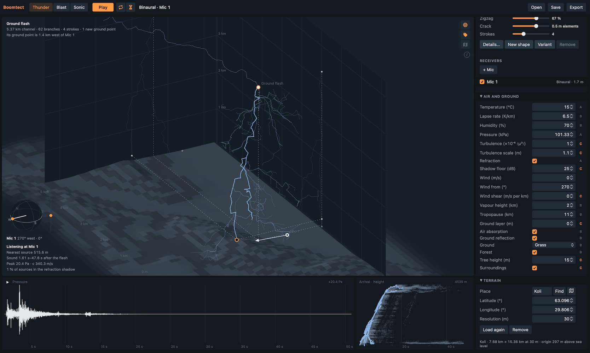

# Boomtect: Make your own thunder

Boomtect simulates the sound of lightning, blasts, and sonic booms from their physics. Shape
a flash or a whole storm in 3D above the ground, place microphones, and hear
how distance, height, layered air, terrain, and ground shape what arrives. Listen in mono, as a
spaced stereo pair, or binaurally on headphones, and export WAV or Ambisonics.
Made for sound design, built on physics.

See it live: [**https://janne-s.github.io/Boomtect/**](https://janne-s.github.io/Boomtect/)



## How it works

Every source is a set of points, each with a position, an emission time, and a
pressure pulse. A lightning channel is thousands of them along a branching,
zigzagging path; a blast is one. Each pulse travels to each microphone with its
own delay and loss, and the microphone hears their sum.

Thunder, Blast, and Sonic are separate modes, each with its own scene. A
supersonic body's booms leave its flight path where the sound reaches a
microphone along the Mach cone.

## Scene

- **Box** — The floor is the ground and the two far walls show the scene from
  the side. The cross on the floor is the origin. The box measures the scene;
  loaded terrain goes on beyond it and fades toward its own edge.
- **Points and shadows** — Drag a point to move it horizontally, or its shadow
  on the floor or a wall to move it in that plane.
- **View** — Drag empty space to turn, pinch or wheel to zoom, two fingers,
  Shift-drag, or the right button to pan, double-click to reset.
- **Channel ends** — A channel starts at the dark circle and ends at the white
  one. A storm's edge handle sets its size, and its grey handles move the
  cloud base and top up and down.
- **Selection** — Dashed lines lead from a selected microphone, blast, or channel
  end to its shadows on the floor and walls. A click on empty space clears it.
- **Shadow boundary** — The line on the ground beyond which refraction lifts the
  selected emitter's sound off the ground, for the microphone's height.

## Emitters

- **Ground flash** — A channel from the ground into the cloud, where it spreads
  sideways. Later strokes follow the same channel or strike a new ground point.
- **Cloud flash** — A channel inside the cloud; its sound spreads out in time.
- **Storm** — Ground and cloud flashes over an area, a time span, and a cloud
  layer.
- **Blast** — An explosion of a given charge: its shock, the secondary shock
  that follows it, and the roar of its fireball and debris.
- **Barrage** — Rounds landing over an area in salvos, as artillery fires,
  each a blast; some may burst in the air.
- **Fireworks** — Shells fired from mortars over an area in salvos: each
  mortar's thump on the ground, the shell's burst high in the air a flight time
  later, and, for a share of the shells, crackling stars as a swarm of tiny
  pops around the burst. In the scene each shell bursts in its own color.
- **Flight** — A supersonic body: a reconnaissance aircraft, a bomber, a launch
  vehicle, or a body of its own length and shape. It climbs, accelerates, and
  turns as set; its booms focus where its rays converge, and the air can turn
  them away before the ground. Supersonic at its start, it has flown straight
  there, so the ground around the start hears it too.
  Far downwind of the upper wind, 200 km or so away, its boom comes back from
  the stratosphere a quarter of an hour later as a low rumble.
- **Formation** — Aircraft flying in a vee behind a leader, each with its own
  booms.
- **Meteor** — A meteoroid entering the atmosphere down to the height where its
  trail ends; its boom leaves the trail where its Mach cone reaches the
  microphone. Its fragments break up in generations where the air's pressure on
  them exceeds their strength, and it bursts where the trail ends, each a blast
  high in the air. A new meteor follows the Chelyabinsk fireball's track of
  2013, mirrored to fly east, as a 1 m body; its diameter takes it toward the 19 m original.
- **Shower** — Meteoroids from one radiant over an area and a time span.
- **Whip** — A bullwhip's crack: the boom of its tip, which passes the speed of
  sound, speeds up, turns over as the lash rolls out, and slows down again,
  all within about a millisecond and a metre. The crack is loudest ahead of
  and above the turn and weak behind it.
- **Booster** — A rocket's first stage falling back to its landing pad, tail
  first, slowed by the air as it thickens. Its boom is a triple boom: a front
  shock, a middle shock from the grid fins and the folded landing legs, and a
  rear shock.
- **Macros** — Energy, height, branching, zigzag, crack, and strokes for a
  flash; size, duration, flashes, ground share, and cloud layer for a storm;
  charge, height, and fireball for a blast; size, duration, rounds, rounds per
  salvo, charge, and fireball for a barrage; size, duration, shells, shells per
  salvo, shell size, and crackle for a fireworks display, each with its onset when the scene
  has more than one emitter or the onset is set; Mach, height, heading, climb,
  acceleration, turn, and flight time for a flight, and the number of aircraft
  for a formation; speed, diameter, entry angle, height, heading, and end height
  for a meteor; meteors, size, duration, speed, diameter, and entry angle for a
  shower; tip speed, height, heading, climb, and cracker length for a whip;
  start height, start Mach, descent angle, heading, and ballistic coefficient
  for a booster.
  Each sets several parameters at once. A macro that sets one parameter takes a
  typed value when its value is pressed, beyond the slider's span within the
  parameter's range; metres and charges take their units (m, km; g, kg, t, kt).
- **Details** — Every parameter, marked A (first principles), B (literature),
  or C (heuristic or synthetic).
- **Explosive** — A blast's explosive, which times its secondary shock. The
  charge stays a TNT equivalent.
- **New shape** — Draws a new random seed.
- **Variant** — Copies the emitter with a new seed and switches the original
  off.
- **Onset** — Delays an emitter in the scene.

## Listening

- **Render** and **Play** — The button renders the scene when it has changed,
  then plays it: it flashes the sources and plays what the listening microphones
  hear.
- **Pause** — The button on the pressure plot holds playback where it is; Play
  goes on from there, Stop starts over.
- **Scrubbing** — Press either plot to move playback to that moment, and drag to
  move it further; on release it plays on from there. Sound fades in and out
  as it starts and stops.
- **Auto** (circling arrows, beside Play) — Renders again soon after every
  change. Off, changes wait for Render.
- **In progress** — Rendering and loading are listed in the corner of the
  scene while they run, each with how far it has come, how long it has run, and
  for requests over the network when it gives up. The last message stands above
  them: a note fades, an error stays.
- **Settings** (gear) — How much of the sound a render computes, kept with the
  scene: the cutoff level, the highest frequency, the flash detail (how many
  segments one source stands for), the echo detail (the echo cells' size), a
  scattered echo's arrivals, a coarse forest (on a coarse frequency grid), and
  shared scatter (a frame's scattered echoes spread in a few groups), with the cost against the full computation and an
  estimate of its time from the last render; the preview; and the threads this
  device renders on.
- **Preview** (gauge, beside Play) — Renders a lighter version of the scene's
  settings: a flash's sources merged in fours, echo cells twice as large, and
  sound up to 2 kHz at most.
  About as loud, as long, and as dark as the full render, a few times quicker
  over terrain. An export is always rendered in full.
- **Real delay** (hourglass, beside Play) — On: the sound arrives as late as it would outdoors, and the
  clock in the corner counts from the flash, its bar brightening when the sound
  arrives. Off: the silence before the first sound is skipped, and the channel
  glows where the sound being heard comes from.
- **View switches** — Down the scene's right edge, each icon lit while on, only
  those that apply.
- **Wavefront** — While the sound plays, shows the wavefronts as ripples where
  they cross the floor, the terrain, and the walls, fading as their sound
  spreads out and the air absorbs it. On in every mode at first.
- **Cone** — While the sound plays, each supersonic body's Mach cone trails behind
  it through the fronts it has left, within the box and above the ground.
- **Names** — Place names, peaks, and lakes on the terrain. Switched on over
  terrain without names, it asks for them again.
- **Map** — A topographic map flat on the floor in place of the terrain's relief,
  in the scene's colours.
- **Cloud** — A storm's cloud as dark fog, lit around the flashes inside it.
- **i** — The sources of the terrain and map data.
- **Phone** — The scene fills the screen. The parameters open one group at a
  time from the icons along the bottom, the plots fold into a strip that opens
  over the scene, and the selection's and the listening microphone's facts open
  from the name at the top.
- **Listen** — The checkbox on a microphone adds it to what plays. During
  playback, the sound continues from the same moment with the new combination.
  Microphones that do not listen still show their level, muted.
- **Type** — Omni hears the pressure. Binaural hears the sound field, turned to
  its orientation and decoded for headphones; it switches Spatial on. A new
  scene starts with a binaural microphone facing its emitter; microphones
  added later are omni, facing the first emitter that sounds.
- **Orientation** — Facing and elevation of a binaural microphone. On the
  sphere beside the scene, drag the handle on the horizon to face and the one
  on the scale beside it to tilt, or drag the arrowhead in the scene.
- **Combinations** — One omni microphone is mono, two are a stereo pair, more
  are one channel each. One binaural microphone is binaural; binaural and omni
  together are a stereo mix with the omni microphones in the centre. Surround
  plays one channel per speaker when the output has them, and otherwise as a
  stereo preview.
- **Spatial** — The Ambisonic order of the render, or Off.
- **Ear reflex** — The middle-ear reflex: after a loud onset, the low
  frequencies are turned down with a short delay, and the effect fades while
  the sound continues.
- **Loudness** — Compresses level differences the way perceived loudness
  grows with pressure (Stevens' power law, the same at every frequency).
- **Cap onsets** — Keeps Loudness from making a sharp onset after quiet, such
  as a boom's front, louder than it was: the level it follows lags the onset,
  so the quiet's boost would carry into it. On at first.
- **Level** — Normalizes to the peak, or uses a fixed full scale in pascals.
  A fixed scale keeps sounds as loud as each other as they are outdoors. A
  boom or a near blast reaches 100–1 000 Pa (134–154 dB), far beyond what
  speakers or headphones play; Ear reflex and Loudness give some of what the
  ear does with it. The warning gives how far what plays goes above full
  scale; 20 dB and more may break up the playback, not only clip it.
- **Plots** — Pressure, and arrival time by source height (Thunder) or by the
  direction the sound comes from (Blast), for every microphone on one time axis
  and one pressure scale, each in its own color and the muted ones dimmer. A microphone's tab, or selecting the microphone, brings it
  forward.

## Air

- **Lapse rate** — How fast the temperature falls with height; 6.5 K/km is the
  standard atmosphere, a negative value an inversion.
- **Refraction** — Sound bends toward slower air. Falling temperature
  bends it up and leaves a shadow on the ground, where thunder fades out; an
  inversion bends it down and carries it far. Off: homogeneous air, the
  free-field reference.
- **Shadow floor** — How far below the unbent level the shadow can go, set by
  turbulent scattering.
- **Ground** — What the ground is made of. Water reflects like rigid ground.
- **Forest**, **Tree height**, and **Forest density** — Trees around the scene:
  sound under their canopy is muffled, and the forest answers every sound with a
  reverberant tail; a sparser forest does both less.
- **Surroundings** — Over level ground, the long rumble the land around returns
  of a loud sound. Over terrain with echoes, the echoes take its place.
- **Wind**, **Wind from**, and **Wind shear** — The wind at the ground, the
  compass direction it comes from, and how much it strengthens with height.
  Downwind, sound bends down and carries; upwind, the shadow comes closer.
- **Upper wind** and **Upper wind from** — In Sonic mode, the wind around the
  stratopause, about 50 km up, that brings secondary booms back to the ground.
- **Vapour height** — How quickly the water vapour thins out with height,
  which changes how much the upper air absorbs.
- **Tropopause** — Where the temperature stops falling; above it the air keeps
  one temperature.
- **Ground layer** and **Layer lapse** — A layer of air next to the ground with
  its own lapse rate, such as a low inversion on a calm night.

## Terrain

- **Place** — Where the scene's origin lies, saved with the scene with or
  without terrain. The map button opens a map to move under the centre mark,
  with the area the scene needs around it. Loaded terrain follows the place.
- **Resolution** — The spacing of the heights. A scene too large for the
  terrain's budget takes a spacing two or more times as coarse.
- **Find** — Finds a place by name, or takes "latitude, longitude".
- **Load terrain** — Fetches the elevation the scene needs and saves it in the
  scene, so the scene opens the same way later without a connection. Place
  names follow on their own. The terrain is held in square patches: those under
  the emitters and microphones and, around them, a quarter of the scene's size
  (at least 1 km) for the slopes that echo. Move or add something past the
  edge and the patches it now needs load a moment later; those no longer needed
  are dropped.
- **Terrain** — Microphones, blasts, and ground points stand on the ground;
  heights in the cloud are above the ground at the origin. The panel shows both
  heights above the ground and above sea level, and the box's height lines are
  above sea level.
- **Shielding** — Hills between a source and a microphone block the direct and
  the reflected sound, and sound bends over their crests, more at low
  frequencies.
- **Echoes** — Slopes the source and the microphone both see send the sound
  back: sharply from where they mirror it, and scattered from everywhere else.
- **Scattering** — The share of the echo that scatters; the rest mirrors.
- **Echo cells** — Sources this close together share their echoes.
- **Echoes per cell** — The strongest echoes kept for each cell.
- **Contours** — Stripes the terrain by height.

## Export

**Export** packs the chosen files, several of them in a ZIP:

- **Scene (JSON)** — The full scene as JSON, with the files, the time of their first
  sample after the flash, and the pascals at full scale. It opens as a scene.
- **Stereo** — What plays, in two channels: mono on both, a pair left and right,
  more microphones panned, binaural as heard on headphones.
- **Microphones** — One file per microphone: an omni's pressure in mono, a
  binaural microphone in stereo.
- **Ambisonics** — One AmbiX file per microphone (ACN, SN3D; front is north,
  left is west), when the render is spatial.

All files are 32-bit float at one full scale. Files of more than two channels
are WAVE_FORMAT_EXTENSIBLE with no speaker positions. With per-microphone files,
every file starts at the same moment.

## Echotect

For echoes from buildings and streets, place a Boomtect sound in an
[Echotect](https://github.com/janne-s/Echotect) echo field: export a
microphone's file and load it in Echotect as the source sound.

## Model

Every part of the model is marked with a class that says how far it can be
trusted, here and in the details of each parameter:

- **A** — Derived from first principles, such as travel time in uniform air.
- **B** — An approximation from the literature, valid in the range its source
  gives.
- **C** — A heuristic or synthetic assumption, chosen to behave plausibly
  rather than derived or measured.

B/C marks a part that combines the two.

| Part | Model | Class |
|---|---|---|
| Speed of sound | `c = sqrt(γRT)` | A |
| Temperature profile | layers: a ground layer, the troposphere, constant above the tropopause (ISO 2533) | B/C |
| Sound speed along a path | linear from the ground, matched to the layered speed's mean slowness over the path's heights | C |
| Travel time, rays, and spreading | circular rays in a linear `c(z)`, ray tubes; `1/R` without refraction | A |
| Wind | effective sound speed along each path, linear in height | B/C |
| Refraction shadow | grazing ray, creeping wave along the ground (Fock), softer over porous ground at high frequencies, floor; over terrain, heights above the mean ground plane between source and microphone (CNOSSOS-EU) | B/C |
| Segment directivity | straight line element | A |
| Lightning pulse | N-wave, period `2.81·R₀/c`, `R₀ = sqrt(E/(πp))` (Few, ReVelle) | B |
| Weak shock | period grows as `x^¼`, extra decay `x^-¼` (ReVelle) | B |
| Strokes | lognormal intervals, new ground points | B/C |
| Return-stroke current | decays with height, `e^(-z/λ)` (MTLE); energy as its square | B/C |
| In-cloud channels | sideways channels from a ground flash's top, thinning out | C |
| Channel shape | seeded two-scale zigzag with branches of branches | C |
| Lightning level | acoustic share of channel energy | C |
| Blast | Friedlander pulse, Kinney & Graham overpressure | B |
| Blast aging | weak shock of a spherical wave: positive phase grows as `√(1 + σ·ln(r/r₀))`, peak falls by as much; a merged ground front ages as twice the pressure | B/C |
| Secondary shock | delay by the explosive's detonation velocity and density (Rigby & Gitterman); a 4 % charge's shock | B |
| Fireball roar | seeded noise burst fitted to recordings of improvised charges on open grass; its ground reflection uncorrelated | C |
| Barrage | rounds seeded over a disc, salvos spread over the duration, charges lognormal about the mean | C |
| Sonic boom | leaves where a microphone's arrival time along the flight path is stationary (Mach cone); none when subsonic or cut off by the air | A |
| Approach | a body supersonic at its start flew straight before it, at the start's speed | C |
| Boom pressure and duration | Carlson's simplified method (NASA TP-1122) along the ray, without his atmospheric chart factors | B/C |
| Turbulent boom front | the front plus 24 seeded sub-arrivals of zero sum, delayed by the rise time on average, at half its amplitude in RMS and growing with the turbulence; each part rises in a tenth of the rise time | C |
| Boom echoes | over terrain, each boom echoes as a point source where it leaves the path, at its pressure along its ray | C |
| Boom beyond its carpet | where the air turns the rays away before the ground, the boom creeps along the ground into the refraction shadow, as other sources' sound does, losing high frequencies first, down to the shadow floor | B/C |
| Secondary boom | rays that turn back above the tropopause: standard-atmosphere warming above 20 km, the upper wind as a jet at 50 km, rays in the stratified effective sound speed, stationary in emission time; Carlson's boom over the ray's length with its ray-tube spreading and focusing, absorption along the ray, no shock left; no thermospheric returns | B/C |
| Focused boom | √ of the steady flight's arrival curvature over the actual, up to 5× | B/C |
| Whip | tip at Mach 1 to 2.19 within 45 cm, back to Mach 1 within 20 cm after the turn (Krehl & Engemann 1998); turn radius, subsonic ends | B/C |
| Fireworks shell | burst at 1.4 m per mm of diameter (Wharton 1995), spread 20 %; flight straight up against drag, `C_D` 0.75 (Ooki et al. 2006), mass 0.4 kg at 100 mm; burst at the top of the flight | B/C |
| Fireworks burst | TNT blast of 15 % of the shell's mass, fitted to 718 Pa below 4–6 inch shells bursting at 91 m (Maglieri & Henderson 1973); TNT's pulse, longer than their 12 ms signature | C |
| Mortar thump | TNT blast of 1 % of a lift charge of 10 % of the shell's mass, positive phase 5 ms | C |
| Crackling stars | stars thrown at 40 m/s, slowed by drag; pops of 0.1 mg TNT at seeded times 0.5–2 s after the burst where the star is | C |
| Booster | fall under gravity and drag `ρv²/(2β)` to the pad; the ballistic coefficient β, 1 500 kg/m² by default, brings a Falcon 9 below Mach 1 at about 6 km (Durrant et al. 2022); start after the entry burn | A/C |
| Booster boom | Carlson's boom, 47 m and `K_S` 0.1 fitted to 130 Pa and 0.29 s measured 8 km from the pad (Durrant et al. 2022); a triple boom whose middle shock comes at 68 % and jumps 108 % of the front shock, fitted to their waveform; the cause after Anderson & Gee 2025 | B/C |
| Whip crack | Carlson's boom of the cracker, whose `K_S = 2^¼·γ·d/l` gives Whitham's projectile overpressure; a frayed cracker's size and shape | C |
| Meteor | one N-wave from where a microphone's arrival time along the trail is stationary; ReVelle's cylindrical blast wave of the drag energy, blast radius √(E₀/p), weak shock as x^(−3/4); constant speed | B/C |
| Meteor breakup | fragments break in generations, each splitting in two: generation k where ρv² reaches the strength times 2^k, spread lognormally per fragment and seeded; a burst at the end of the trail; each generation and the burst a share of the kinetic energy | B/C |
| Blast high in the air | Sachs scaling of the ground blast to the pressure and sound speed there; positive phase at most 2 s | B/C |
| Shower | trails parallel from one radiant, seeded over a disc and a time span | C |
| Shock front | stays steep against absorption while a shock; merges with its grazing reflection (von Neumann) | B/C |
| Air absorption | ISO 9613-1; with refraction, the mean over the heights a path spans, the vapour thinning out with height | B |
| Ground reflection | Delany–Bazley impedance, spherical-wave coefficient; from the slope under the microphone over terrain | B |
| Forest, under the canopy | ISO 9613-2 foliage attenuation as `0.006·f^(1/3)` dB/m, up to 200 m, with a causal phase | B |
| Forest reverberation | seeded diffuse tail at the microphone, octave times around 1.5 s at 1 kHz (Koli, Finland) | B/C |
| Forest density | scales the foliage loss per metre and the tail's energy; the tail's times stay | C |
| Surroundings | seeded diffuse tail at the microphone over level ground, falling about 9 dB/s, mostly below 250 Hz, fitted to recorded booms | C |
| Ground reflection, partly coherent | ground roughness of 5 cm (Rayleigh) and turbulence scatter a share of the reflection over a few milliseconds | C |
| Repeated ground contacts | rays an inversion or a following wind bends back down, up to six contacts, over level ground | A/C |
| Terrain shielding | thin-edge Fresnel–Kirchhoff diffraction, Deygout's edges | B |
| Rounded ridges | each edge adds a cylinder's loss for its crest's radius (ITU-R P.526), with a causal phase, fading to a thin edge where the ridge is small against the wavelength | B/C |
| Terrain echoes, mirrored | stationary path on the surface, focusing by its curvature | A |
| Terrain echoes, scattered | Lambert's law per patch of ground | B |
| Echoes near the ground | the ground's image at the source and microphone ends, rigid within a blast's nonlinear radius | B/C |
| Echoes through the shadow | a leg in the refraction shadow keeps the shadow floor, as the direct sound | C |
| Echo cells and merging | sources pooled in cells; scattered echoes merged by arrival and direction, each spread over its patches' arrival times | C |
| Turbulence | phase fluctuation of the ground reflection | B/C |
| Ambisonics | spherical harmonics, AmbiX | A |
| Ear reflex | threshold, latency, low-frequency attenuation, adaptation | B/C |
| Loudness | Stevens' power law on the level envelope | B/C |

Boomtect is a creative tool. Where published models exist it follows them,
but a result is a plausible event, not a reconstruction or a measurement.
Levels are model values in pascals and are not calibrated.

## Running locally

```sh
npm start
```

Open http://localhost:8000/. Run the tests with `npm test`.

The model's and the view's tuning values and limits are in `src/domain/constants.js`; the
parameters a scene sets, with their defaults and ranges, in `src/domain/scene.js`.

## Data

Terrain heights: [Terrain Tiles](https://github.com/tilezen/joerd/blob/master/docs/attribution.md)
by Mapzen on AWS Open Data (SRTM, GMTED2010, NED, ETOPO1, EU-DEM, and national
datasets). Place search: [OpenStreetMap Nominatim](https://nominatim.openstreetmap.org/).
Map and place names: © [OpenStreetMap](https://www.openstreetmap.org/copyright)
contributors, through the Overpass API for the names.
Both are fetched only when asked for.

## Third-party code

Binaural decoding uses [Omnitone](https://github.com/GoogleChrome/omnitone)
1.3.0 with its SADIE HRIRs, under the Apache License 2.0
([notice](assets/vendor/omnitone/NOTICE)).

Icons are [Font Awesome Free](https://fontawesome.com) 7.3.1, solid style,
as in Echotect: font under the SIL OFL 1.1, CSS under the MIT License, icons
under CC BY 4.0 ([license](assets/vendor/fontawesome/LICENSE.txt)).

## License

MIT

## Support Boomtect

Support development through [GitHub Sponsors](https://github.com/sponsors/janne-s)
or [Ko-fi](https://ko-fi.com/jannesarkela). See
[Sanara Creations](https://www.sanaracreations.fi/) for related work.
